<a href="https://www.hobi.design">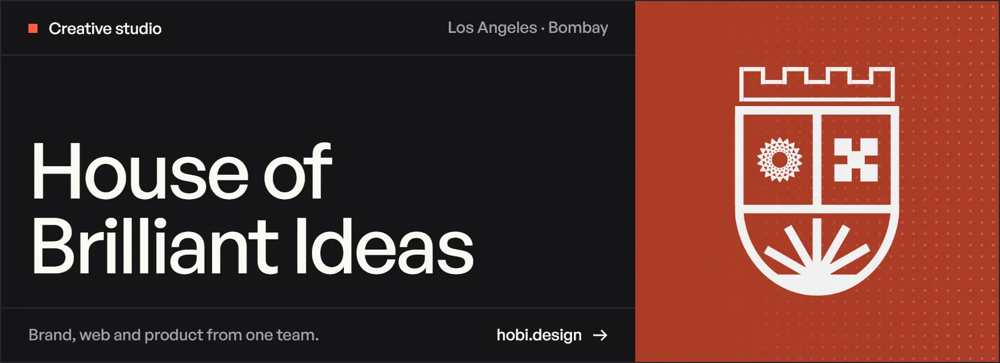</a>
<a href="https://www.hobi.design/capabilities/strategy">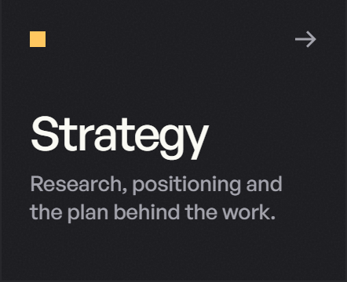</a><a href="https://www.hobi.design/capabilities/product">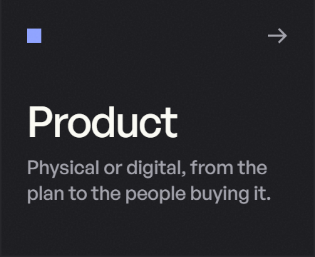</a><a href="https://www.hobi.design/capabilities/brand">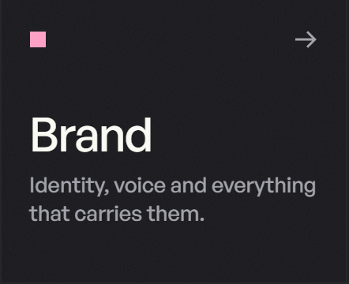</a><a href="https://www.hobi.design/capabilities/design">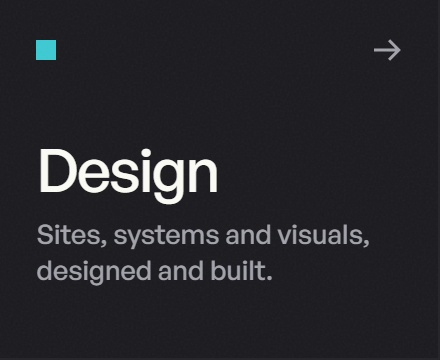</a>

 

House of Brilliant Ideas is a multidisciplinary studio for strategy, product, brand and design. One team takes the work from the first question to the finished product, from Los Angeles and Bombay.

 

<a href="https://www.hobi.design/work/alliciante-jewels">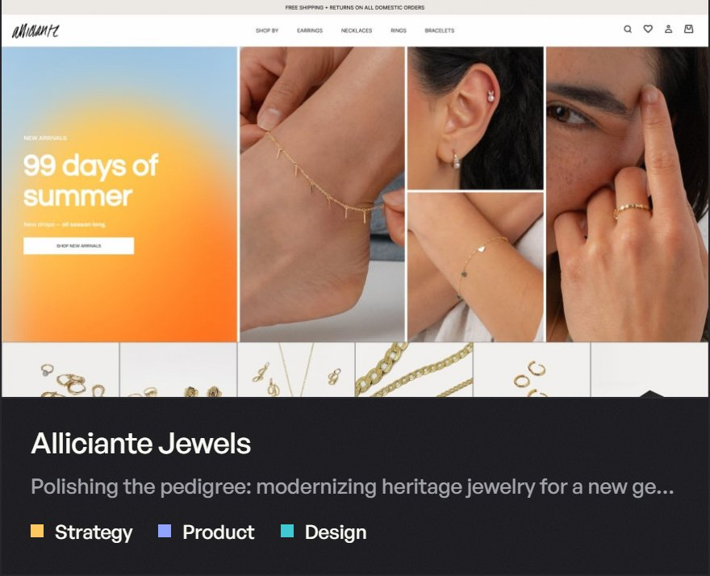</a><a href="https://www.hobi.design/work/arcion">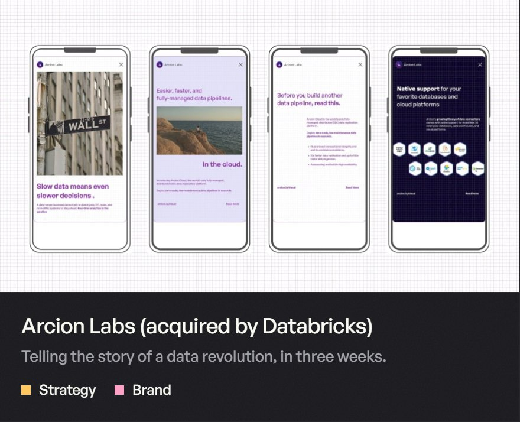</a>
<a href="https://www.hobi.design/work/evolv-technology">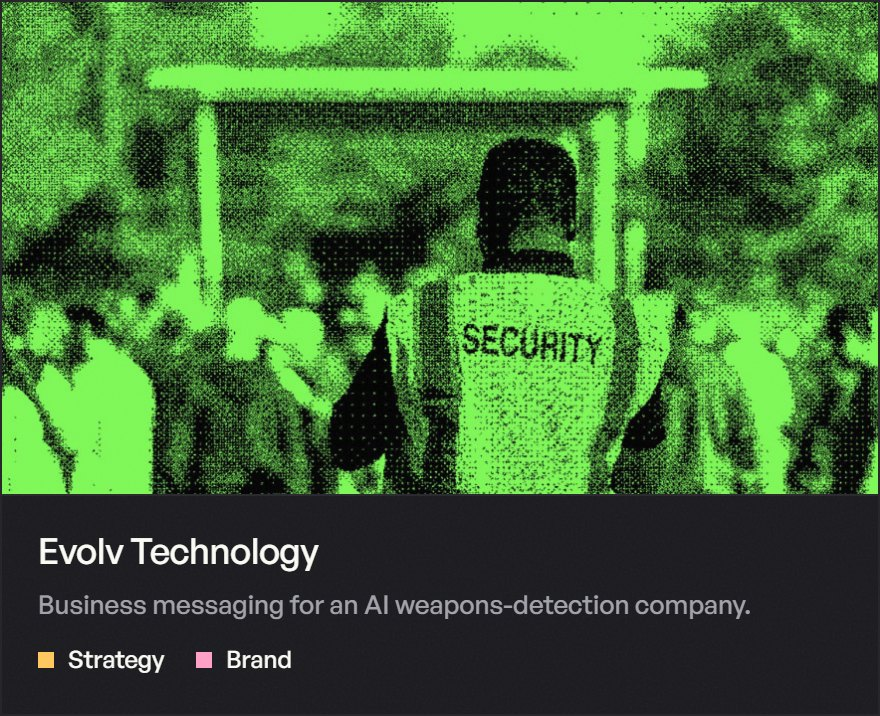</a><a href="https://www.hobi.design/work/smoky-mountain-cbd">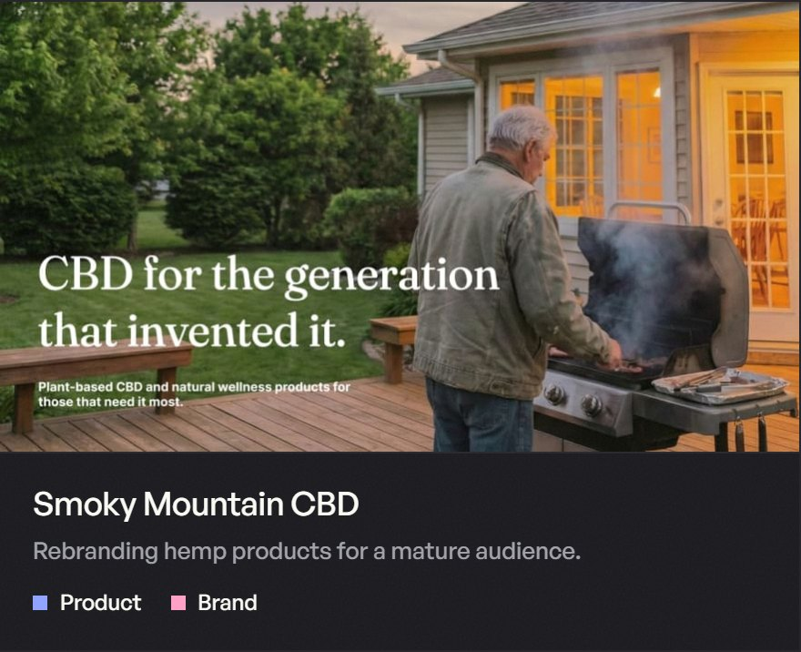</a>
<a href="https://www.hobi.design/lab">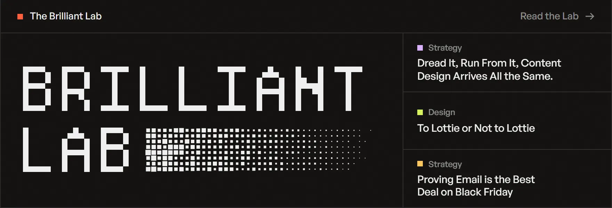</a>
<a href="https://www.hobi.design/contact">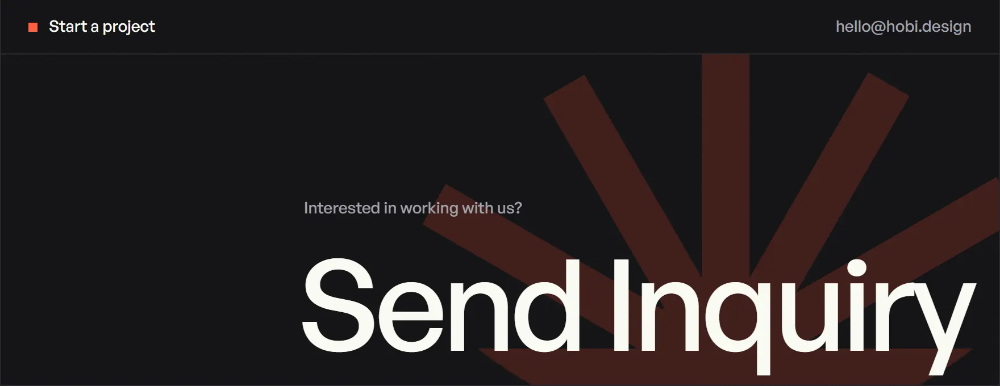</a>

 

**Products** · [*PROPS!*](https://props.tools/) · Substrate and Scout, coming soon 
**Elsewhere** · [hobi.design](https://www.hobi.design) · [Dribbble](https://dribbble.com/HouseOfBrilliantIdeas) · [Behance](https://www.behance.net/brillianideas) · [hello@hobi.design](mailto:hello@hobi.design)
