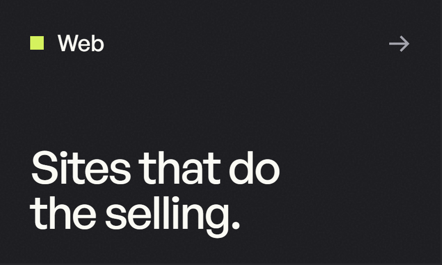

 

House of Brilliant Ideas is a multidisciplinary creative studio creating memorable digital experiences for businesses, big and small. One team for research, design and storytelling, working remotely from Los Angeles and Bombay with clients around the world.

### Work

[Alliciante Jewels](https://www.hobi.design/work/alliciante-jewels) · [Arcion Labs](https://www.hobi.design/work/arcion) · [Evolv Technologies](https://www.hobi.design/work/evolv-technology) · [Smoky Mountain CBD](https://www.hobi.design/work/smoky-mountain-cbd) · [All work](https://www.hobi.design/work)

### Products

[*PROPS!*](https://props.tools/) · Substrate and Scout, coming soon

### Elsewhere

[hobi.design](https://www.hobi.design) · [The Brilliant Lab](https://www.hobi.design/lab) · [Dribbble](https://dribbble.com/HouseOfBrilliantIdeas) · [Behance](https://www.behance.net/brillianideas) · [hello@hobi.design](mailto:hello@hobi.design)
